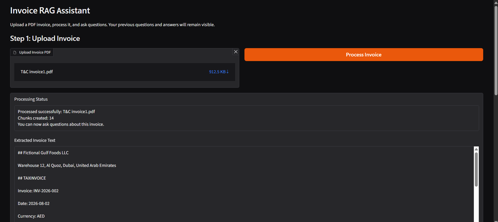
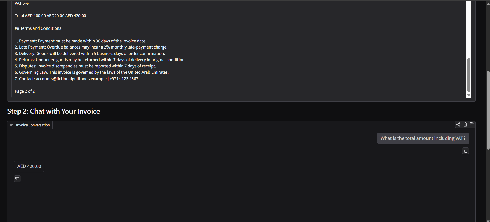
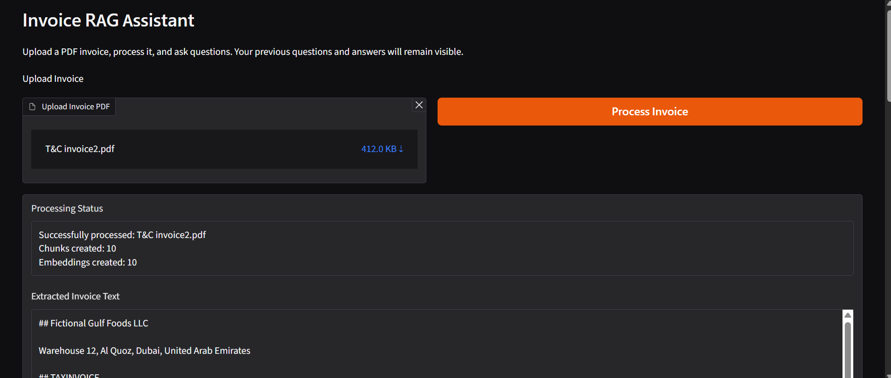
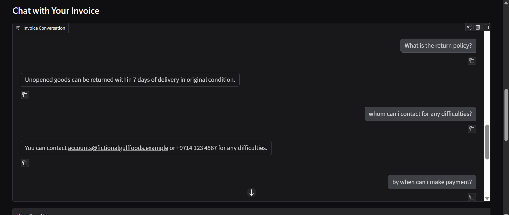

# Invoice RAG Chatbot

An interactive invoice question-answering prototype built with **Docling, Retrieval-Augmented Generation (RAG), FAISS, Sentence Transformers, Llama 3.2 3B Instruct, and Gradio**.

The application accepts a PDF invoice, extracts its content, organizes the extracted text into invoice-aware chunks, retrieves relevant context, and generates answers grounded in the uploaded document. The interface also displays extracted invoice text and source chunks used for the latest answer.

## Key Features

- **PDF invoice ingestion:** Upload a PDF invoice through a Gradio interface.
- **Document extraction:** Use Docling to convert the uploaded PDF into Markdown text.
- **Invoice-aware chunking:** Separate invoice headers, line-item tables, totals, and identifiable Terms and Conditions sections.
- **Semantic retrieval:** Generate embeddings with `sentence-transformers/all-MiniLM-L6-v2` and index them using FAISS.
- **Question answering:** Use `meta-llama/Llama-3.2-3B-Instruct` to answer questions from retrieved invoice context.
- **Source visibility:** Display the retrieved sections and chunks supporting the latest response.
- **Invoice summary:** Support summary-style questions and questions about invoice details, amounts, products, and terms.
- **Interactive interface:** Upload, process, and chat with an invoice using Gradio.

## Workflow

```text
PDF Invoice
    |
    v
Docling PDF Extraction
    |
    v
Markdown Content
    |
    v
Invoice-aware Chunking
(header / line items / totals / terms)
    |
    v
Sentence Transformers Embeddings
    |
    v
FAISS Vector Index
    |
    v
Question -> Context Retrieval
    |
    v
Llama 3.2 3B Instruct
    |
    v
Answer + Retrieved Sources
    |
    v
Gradio Interface
```
## Application Screenshots

### Invoice 1 – Processing and Question Answering






### Invoice 2 – Processing and Question Answering





## Repository Structure

```text
Invoice-RAG-Chatbot/
├── notebooks/
│   ├── 01_invoice_rag_gradio_chatbot.ipynb
│   ├── 02_docling_terms_conditions_invoice.ipynb
│   ├── 03_docling_transport_bill.ipynb
│   └── 04_docling_ben_florentines_bill.ipynb
│
├── screenshots/
│   ├── 01-invoice-1-upload-and-processing.png
│   ├── 02-invoice-1-chatbot-qa.png
│   ├── 03-invoice-1-chatbot-qa-with-retrieved-sources.png
│   ├── 04-invoice-1-chatbot-qa-with-summarization.png
│   ├── 05-invoice-2-upload-and-processing.png
│   └── 06-invoice-2-chatbot-qa.png
│
├── README.md
├── requirements.txt
└── .gitignore
```

The first notebook contains the end-to-end Gradio chatbot implementation and example interface outputs for two invoice examples. The remaining notebooks demonstrate Docling extraction on a Terms & Conditions invoice and two additional bill examples.

## Notebooks

| Notebook | Purpose |
|---|---|
| `01_invoice_rag_gradio_chatbot.ipynb` | End-to-end invoice chatbot: Docling extraction, chunking, embeddings, FAISS retrieval, Llama answer generation, and Gradio UI. |
| `02_docling_terms_conditions_invoice.ipynb` | Docling extraction and RAG experimentation with an invoice containing line items and Terms and Conditions. |
| `03_docling_transport_bill.ipynb` | Docling extraction of a transport bill PDF and display of extracted Markdown. |
| `04_docling_ben_florentines_bill.ipynb` | Docling extraction of another bill PDF and display of extracted Markdown. |

## Example Questions

- What is the invoice number and date?
- What is the total invoice amount including VAT?
- What is the payment deadline?
- What is the late-payment charge?
- What is the quantity and unit price of a specific product SKU?
- What are the Terms and Conditions?
- Summarize this invoice.

## Technology Stack

| Component | Technology |
|---|---|
| Programming language | Python |
| PDF/document extraction | Docling |
| Text embeddings | Sentence Transformers (`all-MiniLM-L6-v2`) |
| Vector similarity search | FAISS |
| Language model | Llama 3.2 3B Instruct |
| Model loading / inference | Hugging Face Transformers, Accelerate |
| User interface | Gradio |
| Notebook environment | Google Colab |

## Setup

### 1. Clone the repository

```bash
git clone https://github.com/<your-username>/Invoice-RAG-Chatbot.git
cd Invoice-RAG-Chatbot
```

### 2. Install dependencies

```bash
pip install -r requirements.txt
```

Install a PyTorch build compatible with the local machine or Colab runtime if it is not already installed. GPU acceleration is recommended for running the Llama model.

### 3. Open the notebook

Open `notebooks/01_invoice_rag_gradio_chatbot.ipynb` in Google Colab or Jupyter.

### 4. Configure Hugging Face access

The notebook loads `meta-llama/Llama-3.2-3B-Instruct`. Access to this gated model may require accepting its Hugging Face access conditions and authenticating with a Hugging Face token. The notebook uses `notebook_login()` for authentication.

### 5. Run the application

Run the notebook cells in order. Upload a PDF invoice in the Gradio interface, select **Process Invoice**, and then ask questions in the chat panel.

The notebook launches Gradio with `share=True`; this creates a temporary public sharing URL. Use it carefully and do not upload confidential invoices to a publicly accessible demo.

## Important Notes

- The chatbot processes **one active invoice at a time**. Processing another invoice replaces the active chunks and FAISS index; it does not maintain a persistent multi-invoice knowledge base.
- The example invoice files are represented in notebook outputs/screenshots. The original invoice PDFs are not included in this repository. Use documents you own or are authorized to process.
- The transport-bill and Ben & Florentines notebooks demonstrate Docling extraction; they are not separate chatbot implementations.
- Extraction quality depends on PDF quality, layout, scan resolution, OCR performance, and document structure.
- The model is instructed to answer from retrieved invoice context and avoid inventing missing details. Generated answers should still be checked against the original invoice, especially for financial or contractual information.
- Do not commit private invoices, customer information, Hugging Face tokens, credentials, or environment files.

## Scope

This repository demonstrates a document-grounded invoice assistant and document extraction experiments. It is a learning/prototype project, not an accounting, tax, or legal verification system.
